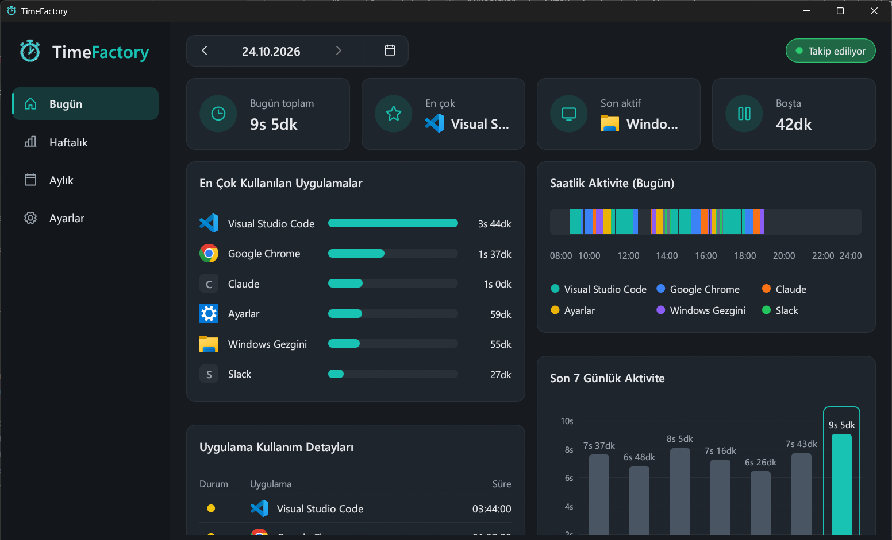
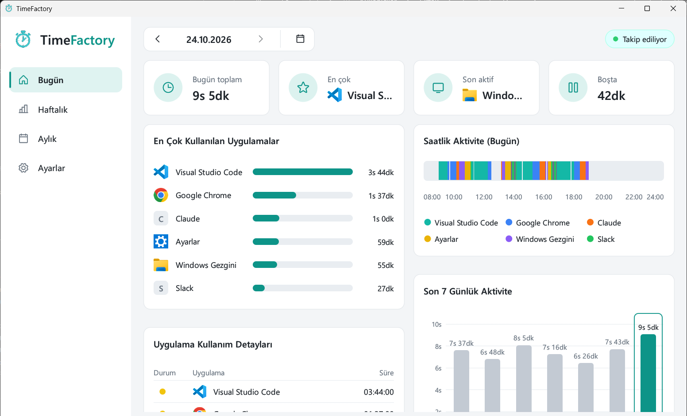
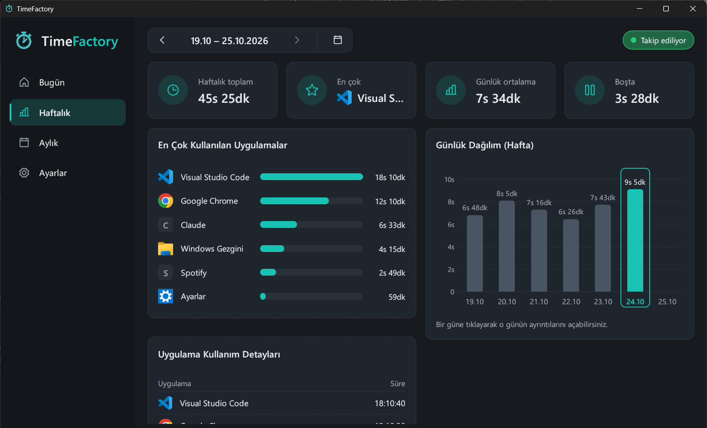
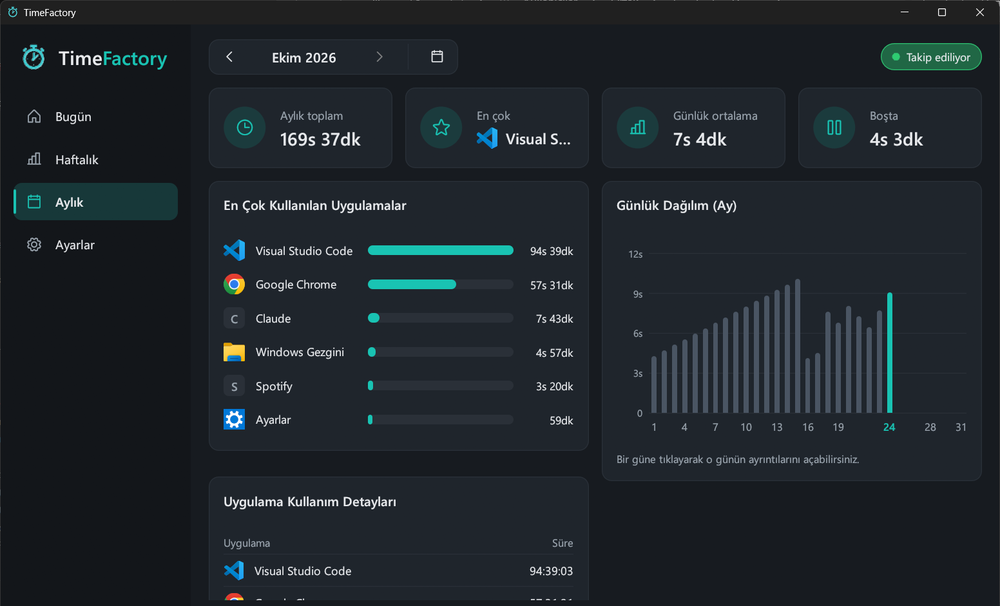
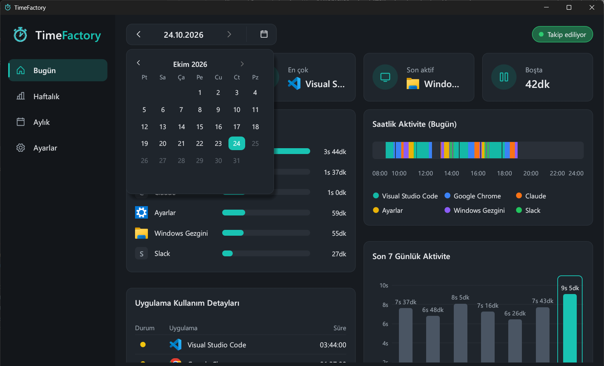
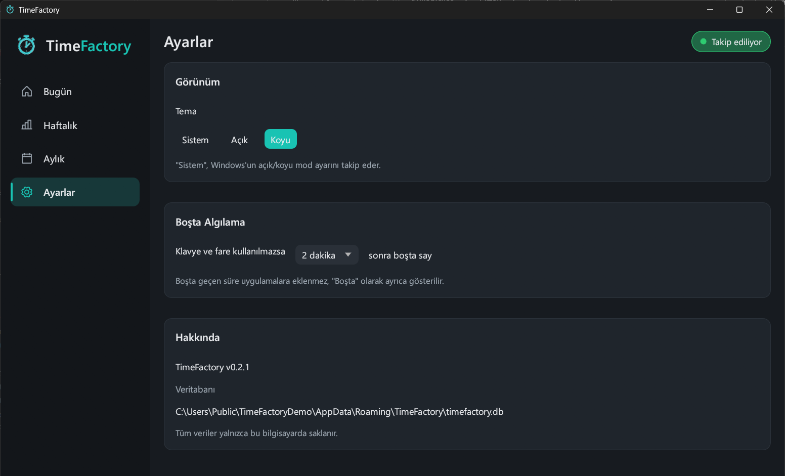

<p align="center">
  
</p>

<p align="center">
  <b>Windows için hafif, tamamen yerel çalışan ekran süresi takipçisi.</b><br>
  Hangi uygulamada ne kadar vakit geçirdiğinizi saniye saniye kaydeder; günlük, haftalık ve aylık grafiklerle gösterir.
</p>

<p align="center">
  <a href="https://github.com/YigitDgn/timefactory/releases/latest"></a>
  <a href="https://github.com/YigitDgn/timefactory/actions/workflows/release.yml"></a>
  <a href="LICENSE"></a>
  
  
</p>

---

## İçindekiler

- [Özellikler](#özellikler)
- [Ekran Görüntüleri](#ekran-görüntüleri)
- [Kurulum](#kurulum)
- [Kullanım](#kullanım)
- [Nasıl Çalışır?](#nasıl-çalışır)
- [Veriler ve Gizlilik](#veriler-ve-gizlilik)
- [Kaynaktan Derleme](#kaynaktan-derleme)
- [Proje Yapısı](#proje-yapısı)
- [Sürümleme ve Otomatik Release](#sürümleme-ve-otomatik-release)
- [Bilinen Sınırlamalar ve SSS](#bilinen-sınırlamalar-ve-sss)
- [Katkıda Bulunma](#katkıda-bulunma)
- [Lisans](#lisans)

---

## Özellikler

- **Ön plandaki uygulamayı takip eder.** Süre yalnızca o an kullandığınız (öndeki) uygulamaya yazılır; arka planda açık duran pencereler sayılmaz.
- **Boşta algılama.** Belirlediğiniz süre (varsayılan 2 dakika) boyunca klavye ya da fare kullanılmazsa süre hiçbir uygulamaya eklenmez, ayrıca "Boşta" olarak kaydedilir.
- **Modern pano (dashboard).**
  - Özet kartlar: toplam süre, en çok kullanılan uygulama, şu an aktif uygulama, boşta geçen süre
  - En çok kullanılan 6 uygulama için gerçek uygulama simgeleriyle çubuk grafik
  - Gün içinde hangi saatte hangi uygulamanın önde olduğunu gösteren **saatlik aktivite şeridi**
  - **Son 7 gün** sütun grafiği (bir güne tıklayınca o güne gidilir)
  - Tüm uygulamaların süreleriyle **ayrıntı tablosu**: yeşil nokta = şu an aktif, sarı nokta = açık ama arka planda
- **Haftalık ve aylık görünümler.** Dönem toplamı, günlük ortalama ve gün gün dağılım grafiği.
- **Takvim.** İstediğiniz güne tek tıkla atlayın.
- **Açık / Koyu / Sistem teması.** "Sistem" seçiliyken Windows'un tema ayarı anlık takip edilir. Başlık çubuğu ve tray menüsü de temaya uyar.
- **Sistem tepsisinde (tray) çalışır.** Pencereyi kapatmak uygulamayı kapatmaz; takip arka planda sürer.
- **Takibi duraklatma.** "Takip ediliyor" etiketine ya da tray menüsüne tıklayarak istediğiniz an duraklatın.
- **Tek kopya.** Uygulama ikinci kez açılırsa yeni kopya kapanır ve çalışan pencere öne gelir.
- **Tek dosya, kurulum yok.** Yaklaşık 5 MB'lık tek bir `.exe`; ek DLL ya da çalışma zamanı gerektirmez.
- **%100 yerel.** İnternet bağlantısı kullanmaz, hiçbir veri dışarı gönderilmez.

## Ekran Görüntüleri

> Görüntülerdeki veriler **temsilidir**; tanıtım amacıyla hazırlanmış örnek verilerle oluşturulmuştur.

**Bugün — koyu tema**



**Bugün — açık tema**



<table>
  <tr>
    <td width="50%"><b>Haftalık görünüm</b><br></td>
    <td width="50%"><b>Aylık görünüm</b><br></td>
  </tr>
  <tr>
    <td width="50%"><b>Takvimle tarih seçme</b><br></td>
    <td width="50%"><b>Ayarlar</b><br></td>
  </tr>
</table>

## Kurulum

1. [**Releases**](https://github.com/YigitDgn/timefactory/releases/latest) sayfasından son sürümü indirin:
   - `TimeFactory-vX.Y.Z-windows-x64.exe`: doğrudan çalıştırılabilir dosya
   - `TimeFactory-vX.Y.Z-windows-x64.zip`: exe + README + lisans
   - `SHA256SUMS.txt`: indirdiğiniz dosyayı doğrulamak için özet değerleri
2. Exe'yi istediğiniz bir klasöre koyun (örneğin `C:\Programlar\TimeFactory\`) ve çalıştırın.

> **Windows SmartScreen uyarısı:** Exe dijital olarak imzalı olmadığı için ilk çalıştırmada "Windows bilgisayarınızı korudu" uyarısı çıkabilir. **Ek bilgi → Yine de çalıştır** ile açabilirsiniz. Dilerseniz dosyanın özetini `SHA256SUMS.txt` ile karşılaştırabilir ya da [kaynaktan kendiniz derleyebilirsiniz](#kaynaktan-derleme).

**Windows açılışında otomatik başlatmak için:** `Win + R` → `shell:startup` yazın ve açılan klasöre `TimeFactory.exe` için bir kısayol koyun.

**Kaldırmak için:** Tray menüsünden **Çıkış** yapın, exe'yi silin. Verilerinizi de silmek isterseniz `%APPDATA%\TimeFactory` klasörünü silin.

## Kullanım

### Sayfalar

| Sayfa | İçerik |
|---|---|
| **Bugün** | Seçili günün özeti, en çok kullanılan uygulamalar, saatlik aktivite şeridi, son 7 gün grafiği ve ayrıntı tablosu. Bu sayfaya tıklamak her zaman bugüne döndürür. |
| **Haftalık** | Pazartesi–Pazar haftasının toplamı, günlük ortalaması, uygulama dağılımı ve gün gün grafiği. |
| **Aylık** | Seçili ayın toplamı, günlük ortalaması ve ayın her günü için sütun grafik. |
| **Ayarlar** | Tema seçimi, boşta algılama süresi, sürüm ve veritabanı konumu. |

Üst çubuktaki **‹ ›** okları sayfaya göre bir gün, bir hafta ya da bir ay ileri/geri gider; takvim simgesi istediğiniz tarihi seçmenizi sağlar. Gelecek tarihler seçilemez.

### Süre gösterimi

| Gösterim | Anlamı |
|---|---|
| `5s 32dk` | 5 saat 32 dakika |
| `48dk` | 48 dakika |
| `35sn` | 35 saniye |
| `01:48:12` | Tabloda saat:dakika:saniye |

### Sistem tepsisi (tray)

TimeFactory, görev çubuğunun sağ altındaki bildirim alanında bir simgeyle çalışır. Simge görünmüyorsa saatin yanındaki **˄** okuna tıklayın.

| Eylem | Sonuç |
|---|---|
| Simgeye **sol tık** | Pencereyi gösterir / gizler |
| Simgeye **sağ tık** | Menü: **Göster**, **Takibi duraklat / Takibe devam et**, **Çıkış** |
| Penceredeki **X** düğmesi | Pencereyi gizler; takip arka planda sürer |
| Menüden **Çıkış** | Uygulamayı tamamen kapatır |

### Durum etiketi

Sağ üstteki etiket takibin durumunu gösterir ve tıklanınca takibi duraklatır ya da devam ettirir:

- 🟢 **Takip ediliyor**: süre sayılıyor
- 🟡 **Boşta**: klavye/fare kullanılmadığı için süre "Boşta"ya yazılıyor
- ⚪ **Duraklatıldı**: hiçbir şey kaydedilmiyor

## Nasıl Çalışır?

TimeFactory iki parçadan oluşur: arka planda saniyede bir çalışan bir **takipçi** ve verileri okuyup gösteren **arayüz**. Takipçi ayrı bir iş parçacığında (thread) çalıştığı için pencere gizliyken de kayıt devam eder.

Her saniye şunlar olur:

1. **Ön plandaki pencere bulunur** (`GetForegroundWindow`) ve sahibi olan işlemin exe yolu okunur.
2. **Okunabilir ad çıkarılır.** Exe'nin sürüm bilgisindeki `FileDescription` alanı kullanılır (örneğin `chrome.exe` → "Google Chrome"). Bu alan yoksa dosya adı kullanılır. Sonuçlar önbelleğe alınır.
3. **Boşta kontrolü yapılır** (`GetLastInputInfo`). Son klavye/fare hareketinden bu yana geçen süre eşiği aştıysa o saniye "Boşta" sayılır.
4. **Veritabanına yazılır.** Ön plandaki uygulamanın günlük toplamına ve o dakikanın kaydına 1 saniye eklenir.
5. **Açık pencereler listelenir** (`EnumWindows`). Bu liste yalnızca tablodaki sarı noktalar içindir; süreye etki etmez.

Açık pencereler listelenirken görünmeyen, başlıksız, başka bir pencereye ait (sahipli) pencereler ve araç pencereleri (tool window) sayılmaz. TimeFactory'nin kendi penceresi hiçbir zaman sayılmaz.

### Veritabanı şeması

Veriler SQLite veritabanında (WAL modunda) tutulur:

| Tablo | Sütunlar | Açıklama |
|---|---|---|
| `usage_daily` | `date`, `process_name`, `seconds` | Uygulama başına günlük toplam süre |
| `usage_minutes` | `date`, `minute`, `process_name`, `seconds` | Dakika bazında kayıt (saatlik aktivite şeridi için) |
| `idle_daily` | `date`, `seconds` | Günlük boşta geçen süre |
| `apps` | `process_name`, `exe_path` | Uygulama simgelerini göstermek için exe yolları |
| `settings` | `key`, `value` | Tema ve boşta süresi gibi ayarlar |

Tarihler `YYYY-MM-DD` biçiminde, dakikalar gün içindeki dakika (0–1439) olarak saklanır. Veritabanını [DB Browser for SQLite](https://sqlitebrowser.org/) gibi bir araçla açıp kendi analizlerinizi yapabilirsiniz.

## Veriler ve Gizlilik

- Tüm veriler yalnızca bu bilgisayarda, şu dosyada tutulur:
  ```
  %APPDATA%\TimeFactory\timefactory.db
  ```
- Uygulama **hiçbir ağ bağlantısı kurmaz**; telemetri, analiz ya da güncelleme kontrolü yoktur.
- Pencere **başlıkları kaydedilmez**. Yalnızca uygulamanın adı, exe yolu ve süreler saklanır. Örneğin hangi web sitesinde ya da hangi belgede olduğunuz değil, sadece "Google Chrome" kaydedilir.
- Yedeklemek için `timefactory.db` dosyasını kopyalamanız yeterlidir (kopyalamadan önce uygulamadan çıkış yapın).

## Kaynaktan Derleme

### Gereksinimler

- Windows 10 veya 11
- [Rust](https://rustup.rs/) (stable)
- Bir C derleyicisi ve kaynak derleyici (SQLite gömülü olarak derlenir, simge ve sürüm bilgisi exe'ye gömülür). İki seçenek var:
  - **MSVC (önerilen):** [Visual Studio Build Tools](https://visualstudio.microsoft.com/visual-cpp-build-tools/) içinde "C++ ile masaüstü geliştirme" iş yükü. Release workflow'u da bunu kullanır.
  - **GNU:** `x86_64-pc-windows-gnu` hedefi ve [MSYS2](https://www.msys2.org/) ile `mingw-w64-x86_64-gcc` (`gcc` ve `windres` PATH'te olmalı).

### Derleme

```bash
git clone https://github.com/YigitDgn/timefactory.git
cd timefactory
cargo build --release
```

Çıktı: `target/release/TimeFactory.exe`

Geliştirme sırasında hızlı derleme ve çalıştırma için `cargo run` kullanabilirsiniz.

> MSVC ile derlenen exe, [`.cargo/config.toml`](.cargo/config.toml) sayesinde C çalışma zamanını statik olarak içerir; Visual C++ Redistributable kurulu olmayan bilgisayarlarda da çalışır.

### Kullanılan başlıca kütüphaneler

| Kütüphane | Kullanım amacı |
|---|---|
| [`eframe` / `egui`](https://github.com/emilk/egui) | Arayüz (OpenGL ile çizim) |
| [`egui-phosphor`](https://github.com/amPerl/egui-phosphor) | Arayüz ikonları ([Phosphor Icons](https://phosphoricons.com/)) |
| [`rusqlite`](https://github.com/rusqlite/rusqlite) | SQLite veritabanı (gömülü) |
| [`winapi`](https://github.com/retep998/winapi-rs) | Pencere takibi, tray, simge okuma, tema |
| [`chrono`](https://github.com/chronotope/chrono) | Tarih işlemleri |
| [`embed-resource`](https://github.com/nabijaczleweli/rust-embed-resource) | Simge, manifest ve sürüm bilgisini exe'ye gömme |

## Proje Yapısı

```
timefactory/
├── .github/workflows/release.yml   # main'e push'ta otomatik release
├── .cargo/config.toml              # MSVC için statik C runtime
├── build.rs                        # Sürümü Cargo.toml'dan alıp exe kaynaklarına gömer
├── Cargo.toml
├── docs/screenshots/               # README görselleri (temsili veriler)
├── resources/
│   ├── app.rc.in                   # Simge + manifest + VERSIONINFO şablonu
│   ├── app.manifest                # DPI farkındalığı, ortak kontroller v6
│   ├── logo.ico                    # Uygulama simgesi
│   └── bannertf.png                # README banner'ı
└── src/
    ├── main.rs                     # Giriş noktası, tek kopya kontrolü
    ├── tracker.rs                  # Win32: ön plan penceresi, açık pencereler, boşta süresi
    ├── tracking.rs                 # Saniyelik takip döngüsü (arka plan thread'i)
    ├── db.rs                       # SQLite şeması ve sorgular
    ├── tray.rs                     # Sistem tepsisi simgesi ve menüsü
    ├── theme.rs                    # Sistem teması, koyu başlık çubuğu ve menüler
    ├── winicon.rs                  # Exe simgelerini RGBA'ya çevirme
    └── ui/
        ├── mod.rs                  # Sayfalar, veri yükleme, uygulama durumu
        ├── widgets.rs              # Kartlar, grafikler, tablo, takvim
        ├── style.rs                # Renk paletleri, yazı tipleri
        └── format.rs               # Süre ve tarih biçimlendirme
```

## Sürümleme ve Otomatik Release

Proje [Anlamsal Sürümleme (SemVer)](https://semver.org/lang/tr/) kullanır. Sürümün **tek kaynağı** [`Cargo.toml`](Cargo.toml) içindeki `version` alanıdır. Uygulama içindeki sürüm yazısı ve exe'nin dosya özellikleri (Özellikler → Ayrıntılar) derleme sırasında buradan doldurulur.

| Değişiklik türü | Örnek | Sürüm |
|---|---|---|
| Hata düzeltme, küçük görsel düzenleme | `0.2.0` → `0.2.1` | PATCH |
| Yeni özellik, davranış değişikliği | `0.2.1` → `0.3.0` | MINOR |
| Geriye uyumsuz değişiklik | `0.x` → `1.0.0` | MAJOR |

**Release akışı:**

1. `Cargo.toml` içindeki `version` değerini artırın.
2. Değişikliği `main` dalına push'layın.
3. [`release.yml`](.github/workflows/release.yml) workflow'u çalışır:
   - O sürüm için zaten bir release varsa hiçbir şey yapmaz.
   - Yoksa projeyi Windows üzerinde derler, `vX.Y.Z` etiketiyle yeni bir GitHub Release oluşturur ve exe, zip ve `SHA256SUMS.txt` dosyalarını ekler. Sürüm notları commit'lerden otomatik üretilir.

Workflow'u **Actions → Release → Run workflow** ile elle de tetikleyebilirsiniz.

## Bilinen Sınırlamalar ve SSS

**Sadece Windows'ta mı çalışıyor?**
Evet. Pencere takibi, tray ve simge okuma Windows API'lerine dayanır.

**Video izlerken süre neden "Boşta"ya geçiyor?**
Boşta algılama klavye ve fare hareketine bakar. Uzun video izlerken bu olabilir; **Ayarlar → Boşta Algılama** süresini artırabilirsiniz (en fazla 30 dakika).

**Boşta eşiğine kadar geçen süre ne oluyor?**
Eşik dolana kadar geçen süre (örneğin 2 dakika) hâlâ öndeki uygulamaya yazılır; eşik dolduktan sonraki süre "Boşta" sayılır.

**Bazı uygulamalarda simge yerine harf görünüyor.**
Simgeler, uygulama TimeFactory tarafından ilk kez görüldüğünde kaydedilen exe yolundan okunur. Exe yolu kaydedilmemiş (örneğin v0.2.0 öncesinden kalan) ya da artık var olmayan uygulamalar baş harfleriyle gösterilir.

**Saatlik aktivite şeridi eski günlerde boş.**
Dakika bazında kayıt v0.2.0 ile eklendi; daha önceki günler için yalnızca günlük toplamlar vardır.

**Bazı Microsoft Store uygulamaları "Application Frame Host" olarak görünüyor.**
Bazı UWP uygulamalarının penceresi Windows'un ortak bir ana işlemi tarafından barındırılır; bu durumda o işlemin adı görünür.

**TimeFactory'nin kendi penceresindeki süre sayılıyor mu?**
Hayır. Pano öndeyken "Şu an aktif" yerine en son kullandığınız uygulama "Son aktif" olarak gösterilir.

**Bilgisayar uykudayken ne olur?**
Uyku sırasında hiçbir şey kaydedilmez; uyanınca takip kaldığı yerden devam eder.

## Katkıda Bulunma

Hata bildirimleri, öneriler ve pull request'ler memnuniyetle karşılanır.

1. Repoyu fork'layın ve bir dal açın: `git checkout -b ozellik/harika-bir-sey`
2. Değişikliklerinizi yapın; göndermeden önce şunları çalıştırın:
   ```bash
   cargo fmt
   cargo clippy --release
   cargo build --release
   ```
3. Değişiklik kullanıcıya görünüyorsa `Cargo.toml` içindeki sürümü [yukarıdaki kurallara](#sürümleme-ve-otomatik-release) göre artırın.
4. Ne değiştirdiğinizi ve nedenini açıklayan bir pull request açın.

## Lisans

[MIT](LICENSE) © 2026 YigitDgn

Kısacası: Bu yazılımı **ücretsiz olarak kullanabilir, kopyalayabilir, değiştirebilir, birleştirebilir, yayımlayabilir, dağıtabilir, alt lisanslayabilir ve satabilirsiniz**. Tek şart, lisans metninin ve telif hakkı bildiriminin yazılımın kopyalarında korunmasıdır. Yazılım "olduğu gibi" sunulur; herhangi bir garanti verilmez.
